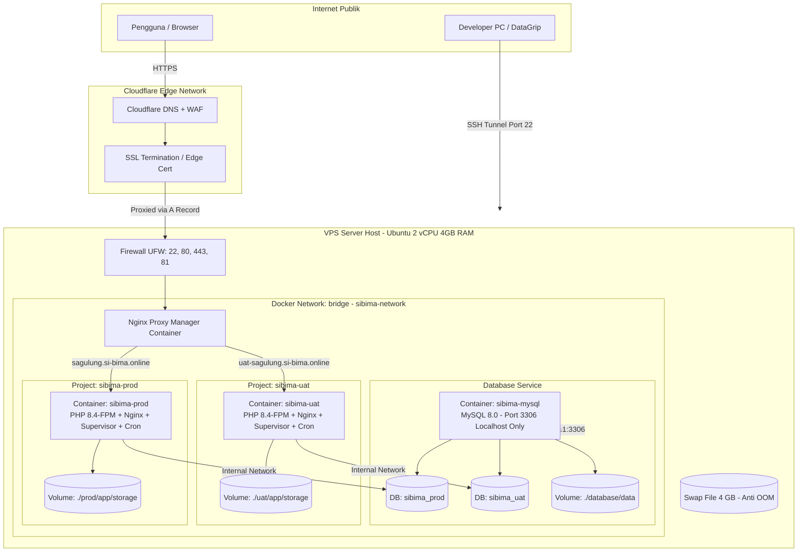

# Standard Deployment Guide & Architecture Playbook — SIBIMA

Dokumen ini adalah standar arsitektur, workflow, struktur folder, dan panduan langkah demi langkah (*step-by-step playbook*) untuk melakukan deployment aplikasi **SIBIMA** (*Sistem Informasi Barang Milik Daerah — Kecamatan Sagulung*) ke lingkungan VPS menggunakan Docker, Nginx Proxy Manager, dan Cloudflare.

Dokumen ini dirancang agar **pengembang manusia maupun AI agent di sesi mendatang** dapat memahami, mereplikasi, dan mengelola alur deployment dengan konsisten, aman, dan tanpa *trial-and-error*.

---

## 1. Topologi & Arsitektur Sistem

Arsitektur ini menerapkan prinsip **Zero Public Database Exposure**, **Multi-Environment Isolation (Production & UAT dalam 1 VPS)**, dan **Reverse Proxy Terpadu**.



---

## 2. Resource Sizing & Kapasitas Server

Sebagai acuan standar untuk VPS skala Pemerintahan Kecamatan (contoh: **2 vCPU, 4 GB RAM, 80 GB SSD**):

| Service / Komponen | Alokasi RAM Rata-Rata | Catatan Konfigurasi |
|---|---|---|
| **OS Ubuntu + Docker Daemon** | ~400 – 500 MB | Base system overhead |
| **Nginx Proxy Manager (NPM)** | ~100 – 150 MB | Reverse proxy, Let's Encrypt SSL manager |
| **MySQL 8.0 (`sibima-mysql`)** | ~600 – 750 MB | Di-tuning: `--innodb-buffer-pool-size=512M` |
| **Aplikasi Production (`sibima-prod`)** | ~350 – 450 MB | PHP 8.4-FPM + Nginx + Worker (`queue:work`) + Cron |
| **Aplikasi UAT (`sibima-uat`)** | ~250 – 350 MB | PHP 8.4-FPM + Nginx + Worker (`queue:work`) + Cron |
| **Swap File Linux** | **4.0 GiB (Wajib)** | **Pencegah OOM Killer saat `npm run build` (`tsc && vite build`) berjalan** |
| **Total RAM Terpakai (Idle)** | **~1.8 – 2.2 GB** | **Sisa ~1.8 GB aman untuk OS page cache & burst traffic** |

> [!CRITICAL]
> **Wajib Membuat Swap 4 GB**:
> Saat deploy, proses kompilasi aset frontend (`npm run build` / `tsc && vite build`) membutuhkan lonjakan RAM 1.5–2 GB. Tanpa Swap, Linux OOM (Out Of Memory) Killer akan membunuh container Production atau MySQL (`Exit Code 137`), menyebabkan 503 Bad Gateway.

---

## 3. Standar Struktur Folder di Server VPS

Seluruh komponen aplikasi dipusatkan di direktori `/opt/sibima` untuk kemudahan *backup*, isolasi, dan manajemen hak akses:

```text
/opt/sibima/
├── npm/                         # Nginx Proxy Manager
│   ├── docker-compose.yml       # Port 80, 443, dan 81
│   ├── data/                    # Konfigurasi Nginx proxy hosts & SQLite internal
│   └── letsencrypt/             # Sertifikat SSL Let's Encrypt
│
├── database/                    # Database MySQL 8.0 Terpadu
│   ├── docker-compose.yml       # Port 127.0.0.1:3306:3306 (Localhost only untuk DataGrip)
│   ├── init/
│   │   └── 01-init.sql          # Inisialisasi DB prod & uat + GRANT privileges
│   └── data/                    # Persistent storage database MySQL
│
├── prod/                        # Lingkungan Production
│   └── app/                     # Git clone dari branch `main`
│       ├── .env                 # COMPOSE_PROJECT_NAME=sibima-prod (disalin dari .env.example)
│       ├── storage/             # Persistent storage (foto aset, BA, laporan, import, logs)
│       ├── scripts/deploy.sh    # Script deploy otomatis Production
│       ├── Dockerfile
│       └── docker-compose.yml   # Config container sibima-prod
│
└── uat/                         # Lingkungan UAT / Staging
    └── app/                     # Git clone dari branch `staging`
        ├── .env                 # COMPOSE_PROJECT_NAME=sibima-uat (disalin dari .env.example)
        ├── storage/             # Persistent storage UAT
        ├── scripts/deploy.sh    # Script deploy otomatis UAT
        ├── Dockerfile
        └── docker-compose.yml   # Config container sibima-uat
```

> [!IMPORTANT]
> **Pemisahan Konfigurasi Spesifik per Branch**:
> - **Branch `staging`** berisi `docker-compose.yml`, `.env.example`, dan `scripts/deploy.sh` yang dikonfigurasi khusus untuk **UAT** (`sibima-uat` / `uat-sagulung.si-bima.online`).
> - **Branch `main`** berisi `docker-compose.yml`, `.env.example`, dan `scripts/deploy.sh` yang dikonfigurasi khusus untuk **Production** (`sibima-prod` / `sagulung.si-bima.online`).
> - **Branch `production` lama**: Tetap dibiarkan dan **tidak boleh diganggu** karena merupakan instance lama yang sedang aktif berjalan.
>
> **Isolasi Project Namespace (Pencegah Container Saling Timpa)**:
> Karena folder aplikasi Prod dan UAT sama-sama bernama `app` (`/opt/sibima/prod/app` dan `/opt/sibima/uat/app`), Docker Compose secara default akan menamai project keduanya sebagai `app`.
> Jika tidak diisolasi, menjalankan deploy di UAT akan **mematikan dan menghapus kontainer Production**, dan sebaliknya!
> **Solusi mutlak**:
> 1. Set `COMPOSE_PROJECT_NAME=sibima-prod` di file `.env` Production.
> 2. Set `COMPOSE_PROJECT_NAME=sibima-uat` di file `.env` UAT.
> 3. Gunakan flag `-p sibima-prod` dan `-p sibima-uat` pada setiap perintah Docker Compose.

---

## 4. Alur Percabangan Git (Branching Workflow)

* **Branch `main`**: Digunakan untuk **Production** (`sagulung.si-bima.online`).
* **Branch `staging`**: Digunakan untuk **UAT** (`uat-sagulung.si-bima.online`).

```text
[Laptop Dev] feature/xxx ──► merge ke `staging` ──► push origin staging
                                                          │
                                                    (Deploy ke UAT)
                                                          │
                                                    (Verifikasi UAT)
                                                          │
[Laptop Dev] merge `staging` ke `main` ──────────► push origin main
                                                          │
                                                    (Deploy ke Production)
```

---

## 5. Panduan Instalasi Awal (Step-by-Step Playbook)

### Langkah 1: Persiapan DNS di Cloudflare
1. Buka DNS Management domain `si-bima.online` di Cloudflare.
2. Tambahkan **A Record** (Mode: **Proxied / Awan Oranye**):
   * `sagulung` ➔ `IP_PUBLIK_VPS`
   * `uat-sagulung` ➔ `IP_PUBLIK_VPS`
3. Pengaturan SSL/TLS Cloudflare:
   * **SSL/TLS Mode**: **Full** (wajib, jangan *Flexible* agar tidak redirect loop).
   * **Always Use HTTPS**: **ON**.
   * **Minimum TLS Version**: **TLS 1.2**.

---

### Langkah 2: Setup Awal VPS (Ubuntu) & Swap Memory
Masuk via SSH ke VPS:
```bash
# 1. Set timezone & update paket sistem
timedatectl set-timezone Asia/Jakarta
apt update && apt upgrade -y
apt install -y curl git ufw htop

# 2. Pasang Swap Memory 4 GB (Wajib anti-crash OOM)
fallocate -l 4G /swapfile
chmod 600 /swapfile
mkswap /swapfile
swapon /swapfile
echo '/swapfile none swap sw 0 0' >> /etc/fstab
sysctl vm.swappiness=20
echo 'vm.swappiness=20' >> /etc/sysctl.conf

# 3. Pasang Docker Engine resmi
curl -fsSL https://get.docker.com -o get-docker.sh
sh get-docker.sh

# 4. Setup Firewall UFW (PENTING: izinkan SSH dulu!)
ufw allow 22/tcp
ufw allow 80/tcp
ufw allow 443/tcp
ufw allow 81/tcp
ufw enable

# 5. Buat Docker Network bersama
docker network create sibima-network
```

---

### Langkah 3: Menjalankan Nginx Proxy Manager (NPM)
```bash
mkdir -p /opt/sibima/npm && cd /opt/sibima/npm

cat << 'EOF' > docker-compose.yml
services:
  npm:
    image: 'jc21/nginx-proxy-manager:latest'
    container_name: nginx-proxy-manager
    restart: unless-stopped
    ports:
      - '80:80'
      - '81:81'
      - '443:443'
    volumes:
      - ./data:/data
      - ./letsencrypt:/etc/letsencrypt
    networks:
      - sibima-network

networks:
  sibima-network:
    external: true
EOF

docker compose up -d
```
* Buka browser: `http://<IP_VPS>:81`
* Login awal: `admin@example.com` / `changeme` (segera ganti email & password).

---

### Langkah 4: Menjalankan Database MySQL 8.0 (Support DataGrip via SSH Tunnel)
```bash
mkdir -p /opt/sibima/database/init && cd /opt/sibima/database

# Buat file inisialisasi SQL
cat << 'EOF' > init/01-init.sql
CREATE DATABASE IF NOT EXISTS sibima_prod CHARACTER SET utf8mb4 COLLATE utf8mb4_unicode_ci;
CREATE DATABASE IF NOT EXISTS sibima_uat CHARACTER SET utf8mb4 COLLATE utf8mb4_unicode_ci;
GRANT ALL PRIVILEGES ON sibima_prod.* TO 'sibima'@'%';
GRANT ALL PRIVILEGES ON sibima_uat.* TO 'sibima'@'%';
FLUSH PRIVILEGES;
EOF

# Buat docker-compose.yml
# Catatan: port 127.0.0.1:3306:3306 di-bind ke localhost host saja,
# aman dari internet publik tapi bisa diakses DataGrip / DBeaver lewat SSH Tunnel.
cat << 'EOF' > docker-compose.yml
services:
  mysql:
    image: 'mysql:8.0'
    container_name: sibima-mysql
    restart: unless-stopped
    ports:
      - '127.0.0.1:3306:3306'
    environment:
      MYSQL_ROOT_PASSWORD: 'PasswordRootKuat123!'
      MYSQL_USER: 'sibima'
      MYSQL_PASSWORD: 'PasswordSibimaKuat123!'
    command:
      - --default-authentication-plugin=mysql_native_password
      - --character-set-server=utf8mb4
      - --collation-server=utf8mb4_unicode_ci
      - --innodb-buffer-pool-size=512M
      - --max-connections=100
    volumes:
      - ./data:/var/lib/mysql
      - ./init:/docker-entrypoint-initdb.d
    networks:
      - sibima-network

networks:
  sibima-network:
    external: true
EOF

docker compose up -d
```

---

### Langkah 5: Deploy Environment Production

```bash
mkdir -p /opt/sibima/prod && cd /opt/sibima/prod
git clone -b main https://github.com/abdlazz00/sibima.git app
cd app

# Abaikan tracking perubahan chmod di repo server
git config core.filemode false

cp .env.example .env

# Tambahkan nama project unik agar tidak bentrok dengan UAT
echo "COMPOSE_PROJECT_NAME=sibima-prod" >> .env

# Edit .env (isi DB_PASSWORD, RESEND_API_KEY, dll)
nano .env

# Jalankan build container dengan project namespace spesifik
docker compose -p sibima-prod -f docker-compose.yml up -d --build

# Generate APP_KEY dan simpan ke file .env host
KEY=$(docker exec sibima-prod php artisan key:generate --show)
sed -i "s|^APP_KEY=.*|APP_KEY=$KEY|" .env
docker compose -p sibima-prod -f docker-compose.yml up -d

# Seeding data master (Role, Permission, Unit, Kategori BMD, 10 Alur Persetujuan) & buat Super Admin pertama
docker exec -it sibima-prod php artisan db:seed --force
docker exec -it sibima-prod php artisan sibima:create-super-admin admin@sagulung.go.id "Super Admin"
```
> [!NOTE]
> Perintah `sibima:create-super-admin` akan mencetak **Password Sementara** di layar terminal (atau gunakan flag `--password="PasswordKuat123!"` jika ingin menentukan sendiri). Segera login dan ubah password melalui menu **Profil Saya**.

---

### Langkah 6: Routing & SSL di Nginx Proxy Manager (NPM)

1. Buka dashboard NPM (`http://<IP_VPS>:81`) ➔ **Hosts** ➔ **Proxy Hosts** ➔ **Add Proxy Host**.
2. **Tab Details**:
   * **Domain Names**: `sagulung.si-bima.online`
   * **Scheme**: `http`
   * **Forward Hostname / IP**: `sibima-prod`
   * **Forward Port**: `80`
   * Aktifkan: `Block Common Exploits` & `Websockets Support`.
3. **Tab SSL**:
   * **SSL Certificate**: `Request a new SSL Certificate`.
   * Aktifkan: `Force SSL` & `HTTP/2 Support`.
   * Isi email & centang persetujuan Let's Encrypt.
4. **Tab Ikon Gerigi (⚙️ / Advanced)**:
   > [!IMPORTANT]
   > Wajib ditambahkan untuk mencegah error **502 Bad Gateway** akibat header keamanan & payload Inertia yang melebihi batas buffer default Nginx:
   ```nginx
   proxy_buffer_size 128k;
   proxy_buffers 4 256k;
   proxy_busy_buffers_size 256k;
   ```
5. Klik **Save**.

---

### Langkah 7: Deploy Environment UAT

Ulangi alur di atas untuk folder `/opt/sibima/uat`:
```bash
mkdir -p /opt/sibima/uat && cd /opt/sibima/uat
git clone -b staging https://github.com/abdlazz00/sibima.git app
cd app

git config core.filemode false
cp .env.example .env

# Tambahkan nama project unik untuk UAT
echo "COMPOSE_PROJECT_NAME=sibima-uat" >> .env
nano .env

# Jalankan build dengan project namespace sibima-uat
docker compose -p sibima-uat -f docker-compose.yml up -d --build

KEY=$(docker exec sibima-uat php artisan key:generate --show)
sed -i "s|^APP_KEY=.*|APP_KEY=$KEY|" .env
docker compose -p sibima-uat -f docker-compose.yml up -d

docker exec -it sibima-uat php artisan db:seed --force
docker exec -it sibima-uat php artisan sibima:create-super-admin admin@uat-sagulung.go.id "Super Admin UAT"
```
Di NPM arahkan `uat-sagulung.si-bima.online` ➔ `sibima-uat:80` dengan tab gerigi ⚙️ buffer yang sama.

---

## 6. Otomasi Deployment Harian (Daily Deploy Commands)

Beri izin eksekusi dan hubungkan shortcut global sekali saja di VPS:
```bash
chmod +x /opt/sibima/prod/app/scripts/deploy.sh
chmod +x /opt/sibima/uat/app/scripts/deploy.sh

ln -sf /opt/sibima/prod/app/scripts/deploy.sh /usr/local/bin/deploy-prod
ln -sf /opt/sibima/uat/app/scripts/deploy.sh /usr/local/bin/deploy-uat
```

Setiap kali ada fitur baru atau perubahan kode:
* **Update UAT**: cukup ketik `deploy-uat` dari folder mana saja.
* **Update Prod**: cukup ketik `deploy-prod` dari folder mana saja.

### Struktur Script Standar `deploy.sh` (Production):
```bash
#!/bin/bash
set -e

echo "🚀 [SIBIMA] Memulai deployment Production (sagulung.si-bima.online)..."
cd /opt/sibima/prod/app

echo "📥 Menarik pembaruan dari branch main..."
git fetch origin main
git reset --hard origin/main

echo "🐳 Membangun dan menjalankan ulang container Production..."
docker compose -p sibima-prod -f docker-compose.yml up -d --build

echo "⚡ Menjalankan migrasi database & seeder alur..."
docker compose -p sibima-prod -f docker-compose.yml exec -T app php artisan migrate --force
docker compose -p sibima-prod -f docker-compose.yml exec -T app php artisan db:seed --class=WorkflowDefinitionSeeder --force

echo "🔄 Me-restart worker antrean (queue)..."
docker compose -p sibima-prod -f docker-compose.yml exec -T app php artisan queue:restart

echo "⚡ Mengoptimalkan cache Laravel..."
docker compose -p sibima-prod -f docker-compose.yml exec -T app php artisan optimize:clear
docker compose -p sibima-prod -f docker-compose.yml exec -T app php artisan config:cache
docker compose -p sibima-prod -f docker-compose.yml exec -T app php artisan route:cache
docker compose -p sibima-prod -f docker-compose.yml exec -T app php artisan view:cache

echo "✅ [SIBIMA] Deployment Production Berhasil dan Live!"
```

---

## 7. Koneksi Database ke DataGrip / DBeaver (SSH Tunnel)

Untuk melihat dan mengelola database `sibima_prod` dan `sibima_uat` langsung dari laptop developer menggunakan **DataGrip** atau **DBeaver**:

1. Buka **DataGrip** ➔ New Data Source ➔ **MySQL**.
2. **Tab SSH/SSL**:
   - Centang **Use SSH tunnel**.
   - Host: `IP_PUBLIK_VPS` (port `22`).
   - Username: `root` (atau user SSH).
   - Auth: Password / SSH Private Key.
   - Klik **Test Connection** (Pastikan sukses terhubung).
3. **Tab General**:
   - Host: `127.0.0.1` (port `3306`).
   - User: `sibima` (atau `root`).
   - Password: Password database dari `docker-compose.yml`.
   - Database: Kosongkan.
4. Klik **Test Connection** ➔ Centang skema `sibima_prod` dan `sibima_uat` di daftar schema.

---

## 8. Troubleshooting Playbook (Penyelesaian Masalah Cepat)

### Kasus 1: Web Production Hilang / 503 Bad Gateway setelah Deploy UAT
* **Gejala**: `sibima-prod` hilang dari output `docker ps -a` setelah mendeploy UAT.
* **Penyebab**: Kedua folder bernama `app` (`/opt/sibima/prod/app` dan `/opt/sibima/uat/app`), sehingga Docker Compose menganggap UAT dan Prod adalah project `app` yang sama. Deploy UAT menimpa dan memusnahkan kontainer Prod.
* **Solusi**:
  1. Hapus bentrok nama lama: `docker rm -f sibima-uat sibima-prod` (jika stuck).
  2. Tambahkan `COMPOSE_PROJECT_NAME=sibima-prod` di `.env` prod.
  3. Tambahkan `COMPOSE_PROJECT_NAME=sibima-uat` di `.env` uat.
  4. Jalankan masing-masing dengan `-p`:
     ```bash
     docker compose -p sibima-prod -f docker-compose.prod.yml up -d
     docker compose -p sibima-uat -f docker-compose.uat.yml up -d
     ```

### Kasus 2: Kontainer Crash Exit Code 137 (OOM Killer) saat Build
* **Gejala**: Proses build Docker berhenti tiba-tiba dengan exit code `137` atau kontainer prod mati saat UAT sedang di-build.
* **Penyebab**: Server kehabisan RAM fisik (4 GB) akibat lonjakan memori TypeScript & Vite (`tsc && vite build`), dan server tidak memiliki Swap Memory.
* **Solusi**: Pasang Swap 4 GB segera:
  ```bash
  fallocate -l 4G /swapfile && chmod 600 /swapfile && mkswap /swapfile && swapon /swapfile
  echo '/swapfile none swap sw 0 0' >> /etc/fstab
  sysctl vm.swappiness=20
  ```

### Kasus 3: Judul Tab Browser Menampilkan "- Laravel" (Masuk - Laravel)
* **Gejala**: Di browser, judul halaman tetap menampilkan kata *Laravel*, bukan nama aplikasi *SIBIMA*.
* **Penyebab**:
  1. `.dockerignore` mengabaikan file `.env`, sehingga saat `npm run build` dijalankan di dalam container, Vite tidak membaca `VITE_APP_NAME` dan mengambil fallback `'Laravel'`.
  2. Fallback di `resources/js/app.tsx` dan `resources/views/app.blade.php` masih diset ke `'Laravel'`.
* **Solusi**:
  1. Di `Dockerfile` stage frontend build, pastikan: `ENV VITE_APP_NAME="SIBIMA"`.
  2. Di `resources/js/app.tsx`, pastikan fallback: `const appName = import.meta.env.VITE_APP_NAME || 'SIBIMA';`.
  3. Di `resources/views/app.blade.php`, pastikan: `<title inertia>{{ config('app.name', 'SIBIMA') }}</title>`.

### Kasus 4: Error "Your local changes would be overwritten by merge" pada Git Pull
* **Gejala**: `deploy-prod` atau `git pull` gagal karena file `.gitignore` di `storage/` atau file script dianggap termodifikasi (*modified*).
* **Penyebab**: Perubahan izin eksekusi (`chmod`) saat Laravel berjalan dianggap Git sebagai perubahan file (`core.filemode=true`).
* **Solusi**:
  ```bash
  git config core.filemode false
  git reset --hard origin/<branch>
  ```
  Dan pastikan script deploy menggunakan `git reset --hard origin/<branch>` alih-alih `git pull`.

### Kasus 5: Error "-bash: /usr/local/bin/deploy-prod: Permission denied"
* **Gejala**: Menjalankan shortcut global gagal karena izin eksekusi hilang setelah `git reset`.
* **Solusi**: Beri izin eksekusi ulang di VPS:
  ```bash
  chmod +x /opt/sibima/prod/app/scripts/deploy-prod.sh
  chmod +x /opt/sibima/uat/app/scripts/deploy-uat.sh
  ```
  *(Di repo lokal, jalankan `git update-index --chmod=+x scripts/deploy-*.sh` lalu commit & push agar Git mengingat atribut executable secara permanen).*

### Kasus 6: Error "502 Bad Gateway / upstream sent too big header"
* **Gejala**: Akses ke halaman web mengembalikan 502 Bad Gateway dari Nginx Proxy Manager.
* **Penyebab**: Header cookie sesi dan header Inertia melebihi batas buffer default FastCGI (4k) dan NPM.
* **Solusi**:
  1. Di `docker/nginx.conf` pastikan FastCGI buffer diperbesar:
     ```nginx
     fastcgi_buffer_size 64k;
     fastcgi_buffers 8 64k;
     fastcgi_busy_buffers_size 128k;
     ```
  2. Di NPM (Tab gerigi ⚙️ Advanced) tambahkan custom configuration:
     ```nginx
     proxy_buffer_size 128k;
     proxy_buffers 4 256k;
     proxy_busy_buffers_size 256k;
     ```

### Kasus 7: Foto Aset / Dokumen Berita Acara Tidak Tampil (404 pada `/storage/...`)
* **Gejala**: Gambar yang diunggah tidak tampil di halaman detail aset atau profil.
* **Penyebab**: Symlink `public/storage` belum mengarah ke `storage/app/public`.
* **Solusi**:
  ```bash
  docker exec sibima-prod php artisan storage:link --force
  ```

### Kasus 8: Port 22 SSH Connection Timed Out setelah UFW Aktif
* **Gejala**: Tidak bisa login SSH ke VPS setelah mengaktifkan firewall.
* **Solusi**: Masuk ke **Web Console / VNC** di dashboard penyedia VPS, lalu jalankan:
  ```bash
  ufw disable
  ufw allow 22/tcp
  systemctl restart ssh
  ufw enable
  ```
